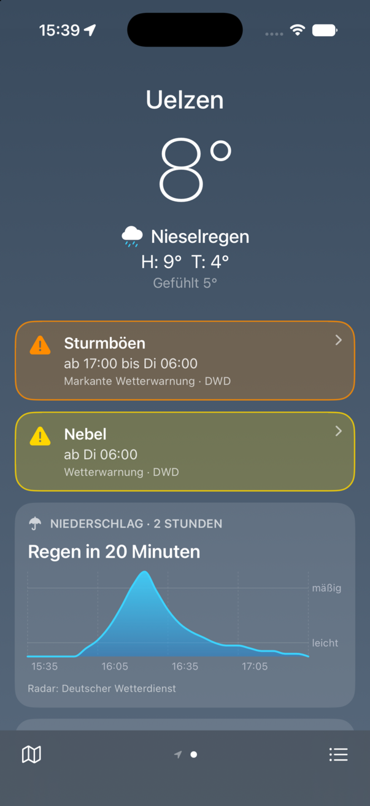

# Witterung für iOS

SwiftUI-App mit Widgets für den Witterung-Server (Meilensteine M3, M4 und die Radarkarte
aus M5). iOS 26, Swift 6 mit strikter Nebenläufigkeitsprüfung, keine Drittabhängigkeiten
(SwiftUI, Swift Charts, MapKit, WidgetKit, App Intents, CoreLocation, CryptoKit).
Anzeige immer deutsch, metrisch, 24 h, Europe/Berlin.



## Bauen

```fish
cd ios
xcodegen generate                      # Witterung.xcodeproj aus project.yml (nicht eingecheckt)
xcodebuild -scheme Witterung -destination 'platform=iOS Simulator,name=iPhone 17 Pro' build test
```

Gerät: in Xcode `Witterung` auf das iPhone, Team `H95J852PKP`, automatische Signierung.
Die App-IDs `dev.rubeen.witterung` und `dev.rubeen.witterung.widgets`, die App Group
`group.dev.rubeen.witterung` und die Schlüsselbundgruppe `…dev.rubeen.witterung.shared`
legt Xcode beim ersten Bauen an (`-allowProvisioningUpdates` auf der Kommandozeile).

### Tests

19 Logiktests (Swift Testing): Dekodieren der Fixture `WitterungTests/Fixtures/forecast.json`
(Uelzen im November, Warnungen, Regen in 25 min, eine Quelle mit Kontingentfehler),
PKCE-Testvektor aus RFC 7636 Anhang B, Nowcast-Sätze, Regenhinweis und stündliche
Widget-Timeline, WMS-BBOX-Rechnung, deutsche Zahlen- und Zeitformate.

Das Testbundle läuft ohne Host-App. Hängt `xcodebuild test` mit „The test runner hung
before establishing connection“ (auf dem Entwicklungsrechner am 09.11.2026 so, der
Instruments-Dienst DTServiceHub ließ sich für keinen Simulator verbinden), startet

```fish
scripts/run-tests.sh <UDID eines gebooteten Simulators>
```

dasselbe Bundle direkt per `simctl spawn xctest`.

## Ausführen im Simulator

Server lokal im Dev-Modus (Hauptcheckout), Orte anlegen:

```fish
cd ../server
set -x WITTERUNG_DEV_AUTH true; cargo run      # 127.0.0.1:8080
curl -X POST localhost:8080/api/v1/places -H 'x-witterung-client: cli' \
  -H 'content-type: application/json' -d '{"name":"Uelzen","lat":52.9656,"lon":10.5594}'
```

In der App unter Einstellungen → Server `http://localhost:8080` eintragen. Bei `localhost`,
`127.0.0.1` und `::1` entfällt die Anmeldung (der Dev-Server nimmt dort unangemeldete
Anfragen an). Ohne Server: `python3 -I scripts/mock-server.py 8090` liefert die Fixture,
zeitlich auf jetzt verschoben, plus echte Radar-Zeitschritte.

Nur in Debug-Builds gibt es Startargumente für Screenshots ohne UI-Automation:

| Argument | Wirkung |
|---|---|
| `-server http://127.0.0.1:8081` | Server setzen |
| `-page 1` | Seite wählen (0 = Mein Standort) |
| `-scrollTo hourly\|daily\|details` | zu einem Abschnitt springen |
| `-screen radar\|places\|settings\|comparison\|days\|attribution` | Ansicht öffnen |
| `-widgetGallery top\|large` | Widget-Ansichten in Originalgröße |

```fish
xcrun simctl location booted set 52.9656,10.5594
xcrun simctl privacy booted grant location dev.rubeen.witterung
xcrun simctl launch booted dev.rubeen.witterung -server http://127.0.0.1:8080 -page 1 -screen radar
```

## Aufbau

```
ios/
├── project.yml        xcodegen: App, Widget-Extension, Tests, Entitlements, Info.plist
├── Shared/            in App und Widget kompiliert
│   ├── Models.swift      Typen aus docs/api.md (explizite CodingKeys)
│   ├── API.swift         Aufrufe, Bearer-Token, 401 → Token weg
│   ├── Storage.swift     App-Group-Defaults, Vorhersage-Cache, Schlüsselbund
│   ├── Weather.swift     Bedingungen (Text, SF Symbol), Nowcast-Satz, Regenhinweis, Widget-Snapshot
│   ├── Formatting.swift  deutsche Zahlen, Zeiten, Alter, Himmelsrichtung
│   ├── Theme.swift       Verläufe je Wetterlage und Tag/Nacht, DWD-Warnfarben
│   └── WidgetViews.swift Widget-Ansichten (auch für die Debug-Galerie)
├── App/               SwiftUI-App
│   ├── AppModel.swift    Zustand: Orte, Vorhersagen, Anmeldung, Server
│   ├── Auth.swift        PKCE (S256) und Geräte-Anmeldung
│   ├── RootView.swift    Blättern zwischen Orten, Leiste unten, Anmeldeseite
│   ├── PlaceView.swift, Sections.swift   Ortsseite und ihre Karten
│   ├── ComparisonView.swift   Quellenvergleich und Quellenstatus
│   ├── RadarView.swift, WMSTile.swift    Radarkarte mit WMS-Kacheln
│   └── PlacesView.swift, SettingsView.swift, AttributionView.swift
├── Widgets/           Widget-Extension (App Intent, Timeline-Provider)
├── WitterungTests/    Logiktests und Fixture
└── scripts/           Mock-Server, Testlauf ohne Instruments-Dienst
```

**Datenfluss.** Die App lädt `GET /api/v1/places` und je Ort `…/forecast`, für „Mein
Standort“ `GET /api/v1/forecast?lat&lon` (CoreLocation, nur während die App aktiv ist,
Wechsel erst ab 1 km). Jede Antwort landet unverändert als JSON im App-Group-Container
(`Forecasts/place-<id>.json`, `current.json`) und wird beim Start sofort angezeigt. Schlägt
ein Abruf fehl, bleibt der Cache stehen, mit Hinweis „Offline · Stand: vor 12 min“; ab 30 min
Alter erscheint der Stand auch ohne Fehler, ab 3 h orange.

**Ortsseite**, von oben nach unten: Temperatur (Messung der DWD-Station, solange sie
höchstens 90 min alt ist, sonst Konsens der Stunde), Bedingung, Höchst-/Tiefstwert,
gefühlte Temperatur; DWD-Warnungen in Warnfarben (Tipp → voller Text); Nowcast (bei Regen
als Karte mit Diagramm, sonst eine Zeile); 48 Stunden als Streifen und Diagramm (Median,
Spannbreite als Fläche, Regen als Balken); 10 Tage mit Temperaturbalken, dahinter blass die
Spannbreite der Quellen (Tipp → Quellenvergleich des Tages); Messwerte; Quellenstatus;
Attribution.

**Widgets.** Klein, mittel, groß, Sperrbildschirm rund, rechteckig und einzeilig. Ort per
App Intent: gespeicherter Ort oder „Mein Standort“ (eigener Standort des Widgets, sonst der
letzte aus der App). Der Provider lädt selbst (Server-URL aus der App Group, Token aus der
gemeinsamen Schlüsselbundgruppe), legt das Ergebnis in den Cache und baut acht Einträge:
jetzt und jede volle Stunde. Damit stimmen Temperatur, Symbol und Regenhinweis auch, wenn
ein Abruf ausfällt. Neuer Abruf nach 30 min; die App stößt nach jeder Änderung an Orten
und nach manuellem Aktualisieren `reloadAllTimelines` an.

**Radar.** `GET /api/v1/radar` liefert WMS-Adresse, Layer, Zeitschritte (−2 h bis +2 h, 5 min)
und `now_index`. Eine `MKTileOverlay`-Unterklasse rechnet je Kachel (x/y/z) die BBOX in
EPSG:3857 und fragt den DWD-GeoServer direkt (WMS 1.3.0, `TIME=…`, 512 px für Retina).
Zeitleiste mit Abspielen; der Vorhersageteil ist orange markiert. Beim Bildwechsel bleibt
das alte Overlay 0,45 s liegen, damit nichts flackert.

## Entscheidungen

- **Kein Paket, ein `Shared/`-Ordner** in beiden Targets: weniger Gerüst als ein Swift
  Package, und das Widget braucht genau Modelle, API, Cache und Ansichten.
- **Projektdatei nicht eingecheckt**, wie bei lichtung; `project.yml` ist die Quelle.
- **Explizite CodingKeys statt `.convertFromSnakeCase`**: Die Strategie würde auch die
  Schlüssel von `by_source` umschreiben (`open_meteo:icon_d2` → `openMeteo:iconD2`).
  Unbekannte Bedingungen werden `.unknown` statt eines Dekodierfehlers.
- **Token im Schlüsselbund ohne `kSecAttrAccessGroup` im Code.** Erster Eintrag von
  `keychain-access-groups` ist `$(AppIdentifierPrefix)dev.rubeen.witterung.shared` in App
  und Widget, damit wird er zur Standardgruppe. `AfterFirstUnlockThisDeviceOnly`: Das Widget
  lädt auch bei gesperrtem Gerät, das Token geht nicht ins Backup.
- **Anzeige fest auf de_DE und Europe/Berlin**, unabhängig von den Geräteeinstellungen.
- **Regenschwelle Nowcast 0,1 mm/h**, Minuten auf 5 gerundet, Wortwahl nach Spitzenwert
  (< 0,5 „Leichter Regen“, ≥ 4 „Starker Regen“). Der Widget-Regenhinweis nimmt zuerst das
  Radar, danach die Stunden (Median ≥ 0,1 mm), höchstens 12 h voraus.
- **Umsortieren:** ein `PATCH position` (0-basiert) für den verschobenen Ort, der Server
  rückt die übrigen nach (`server/src/db.rs`, `update_place`).

## WeatherKit-Attribution im Widget (Frage aus M4)

Apple, [WeatherKit – Get started](https://developer.apple.com/weatherkit/get-started/),
Abschnitt „Attribution requirements“ (abgerufen am 09.11.2026):

> If your apps, web apps, or websites display any weather data from Apple (other than
> weather alerts or value-added services or products, as described below), you must clearly
> display the Apple Weather trademark (Weather), as well as the legal link to other data
> sources.

> When displaying value-added services or products, you agree to attribute the source of the
> data to “Weather”, along with a notice that the data provided by Apple has been modified.

Eine Ausnahme für Widgets nennt die Seite nicht. Daraus folgt für Witterung:

- **App:** Sobald `weatherkit` unter den Quellen mit `ok: true` steht, zeigen Ortsseite und
  Datenquellen die Marke „Weather“ mit Link auf
  `https://weatherkit.apple.com/legal-attribution.html`. Der Quellenvergleich zeigt
  Apple-Werte unverändert, daher gilt dort die erste Regel.
- **Widgets** zeigen nur den Konsens (Median über alle Quellen), also abgeleitete Werte.
  Mittleres und großes Widget tragen dann „Weather · Daten verändert“; der Link steckt in
  der App, die ein Tipp aufs Widget öffnet (Widgets können keine eigenen Links pro Element
  in kleinen Größen). Kleines und Sperrbildschirm-Widget haben keinen Platz für die Marke.
  Das ist eine bewusste Lücke: Ist das zu dünn, das kleine Widget um eine Zeile kürzen oder
  WeatherKit aus dem Konsens der Widgets herausnehmen.
- Warnungen kommen nur vom DWD (plan.md §8), die Auflagen für Apple-Warnungen greifen nicht.

## Screenshots

`docs/screenshots/`, iPhone 17 Pro Simulator, 09.11.2026. Quelle steht im Dateinamen:
**echt** = lokaler Dev-Server (Hauptcheckout, Stand M2) mit Live-Daten von Open-Meteo und
Bright Sky, ohne WeatherKit und Pirate Weather; **mock** = `scripts/mock-server.py` mit der
Fixture, weil es am Aufnahmetag in Uelzen weder Warnungen noch Regen gab. Die Widget-Bilder
sind die Widget-Ansichten in Originalgröße in der Debug-Galerie, nicht der echte
Home-Bildschirm (Widgets lassen sich per simctl nicht ablegen); die Sperrbildschirm-Darstellung
(vibrant, getönt) zeigen sie nicht.

## Offen

- Gerät: Schlüsselbund-Teilen zwischen App und Widget ist im Simulator nie gelaufen (dort ohne
  Anmeldung über localhost). Erst die Installation auf dem iPhone zeigt, ob das Widget das
  Token liest.
- Benachrichtigungs-Einstellungen (ntfy, `/api/v1/settings/notifications`) und Geräteliste
  haben noch keine Oberfläche in der App; die Glocke je Ort (`notify`) ist da.
- Niederschlag heißt im Nowcast immer „Regen“, auch bei Frost.
