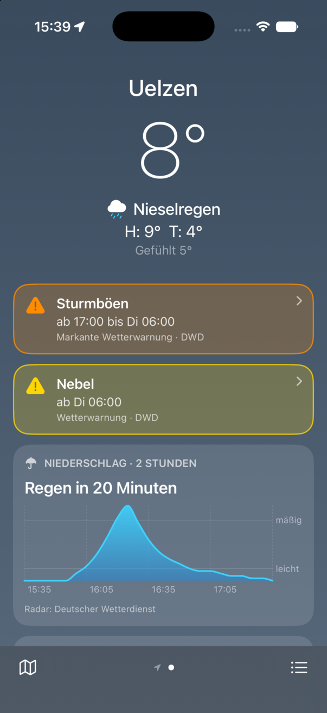

# Witterung für iOS

SwiftUI-App mit Widgets für den Witterung-Server (Meilensteine M3, M4 und die Radarkarte
aus M5). iOS 26, Swift 6 mit strikter Nebenläufigkeitsprüfung, keine Drittabhängigkeiten
(SwiftUI, Swift Charts, MapKit, WidgetKit, App Intents, CoreLocation, CryptoKit).
Anzeige immer deutsch, metrisch, 24 h, Europe/Berlin.



## Bauen

```fish
cd ios
xcodegen generate                      # Witterung.xcodeproj aus project.yml (nicht eingecheckt)
xcodebuild -scheme Witterung -destination 'platform=iOS Simulator,name=iPhone 17 Pro' build test
```

Gerät: in Xcode `Witterung` auf das iPhone, Team `H95J852PKP`, automatische Signierung.
Die App-IDs `dev.rubeen.witterung` und `dev.rubeen.witterung.widgets`, die App Group
`group.dev.rubeen.witterung` und die Schlüsselbundgruppe `…dev.rubeen.witterung.shared`
legt Xcode beim ersten Bauen an (`-allowProvisioningUpdates` auf der Kommandozeile).

### TestFlight

`.github/workflows/ios.yml`: Jeder Push auf `main`, der `ios/` ändert (oder ein Start von
Hand unter Actions → iOS → „Run workflow“), baut die App signiert und lädt sie zu TestFlight
hoch. Nach Apples Verarbeitung (meist 10–30 min) bekommt die interne Gruppe „Ich“ den Build
automatisch, installiert wird über die TestFlight-App. Pull Requests bauen nur unsigniert
(Release, Gerät) und lassen die Logiktests im Simulator laufen.

Signiert wird automatisch über den App-Store-Connect-API-Schlüssel (Rolle **Admin**: Xcode
legt Distributionszertifikat und Profile selbst an). Build-Nummer ist
`<Laufnummer>.<Versuch>` des Workflows, die Version `MARKETING_VERSION` aus `project.yml`.
`ITSAppUsesNonExemptEncryption = false` erspart die Frage nach der Exportkonformität.
`PrivacyInfo.xcprivacy` in App und Widget erklärt die App-Group-Defaults (Grund `1C8F.1`).

Einmalig eingerichtet (11.11.2026): App-IDs `dev.rubeen.witterung` und
`dev.rubeen.witterung.widgets` mit der App Group `group.dev.rubeen.witterung` (automatische
Signierung mit API-Schlüssel kann keine App Groups zuweisen), App-Eintrag „Witterung“ in
App Store Connect (SKU `witterung`), interne Testgruppe „Ich“ mit automatischer Verteilung.
Für die Watch-App kommen zwei App-IDs dazu, ebenfalls mit der App Group
`group.dev.rubeen.witterung`: `dev.rubeen.witterung.watchkitapp` und
`dev.rubeen.witterung.watchkitapp.widgets` (Apple Developer → Identifiers → „+“ → App IDs,
Capability „App Groups“ → Configure → die Gruppe wählen).
Für Live-Aktivitäten per Server-Push braucht `dev.rubeen.witterung` zusätzlich die Capability
„Push Notifications“ (ohne Zertifikat, der Server nutzt einen APNs-Schlüssel).
Dazu im Repo unter Settings → Secrets and variables → Actions:

| Secret | Inhalt |
|---|---|
| `APPLE_API_ISSUER` | Issuer-ID aus App Store Connect → Benutzer und Zugriff → Integrationen |
| `APPLE_API_KEY` | Schlüssel-ID eines Admin-Schlüssels (z. B. „Witterung CI“) |
| `APPLE_API_KEY_P8` | Inhalt der `.p8`-Datei dieses Schlüssels, komplett mit BEGIN/END-Zeilen |

Lehnt Apple den Upload wegen einer schon vorhandenen Build-Nummer ab, den Workflow neu
starten (der Versuch zählt mit). Für eine neue Version `MARKETING_VERSION` erhöhen.

### Tests

60 Logiktests (Swift Testing): Dekodieren der Fixture `WitterungTests/Fixtures/forecast.json`
(Uelzen im November, Warnungen, Regen in 25 min, eine Quelle mit Kontingentfehler),
PKCE-Testvektor aus RFC 7636 Anhang B, Nowcast-Sätze, Regenhinweis und stündliche
Widget-Timeline, WMS-BBOX-Rechnung, deutsche Zahlen- und Zeitformate, dazu
`InsightTests` für jede Regel von „Im Blick“, die Gewichte gegeneinander und die
Kartenreihenfolge, `DecisionTests` für Jevs Entscheidungen (Schwelle, Leitplanken, Ansicht, Fenster, Karten, stabile
Anfrage) `OutlookTests` für Kurztexte, Nacht, Kernsatz, Anzieh-Tipp und „Vorhersage geändert“ und
`PersonalTests` für Termine (auch dass Jev keine Terminnamen sieht), Wochenende, goldene Stunde und
gelernte Vorlieben, `LiveActivityTests` für die Live-Aktivität (dieselben Regeln wie der Server,
sein `content-state` dekodiert).

Das Testbundle läuft ohne Host-App. Hängt `xcodebuild test` mit „The test runner hung
before establishing connection“ (auf dem Entwicklungsrechner am 09.11.2026 so, der
Instruments-Dienst DTServiceHub ließ sich für keinen Simulator verbinden), startet

```fish
scripts/run-tests.sh <UDID eines gebooteten Simulators>
```

dasselbe Bundle direkt per `simctl spawn xctest`.

## Ausführen im Simulator

Server lokal im Dev-Modus (Hauptcheckout), Orte anlegen:

```fish
cd ../server
set -x WITTERUNG_DEV_AUTH true; cargo run      # 127.0.0.1:8080
curl -X POST localhost:8080/api/v1/places -H 'x-witterung-client: cli' \
  -H 'content-type: application/json' -d '{"name":"Uelzen","lat":52.9656,"lon":10.5594}'
```

In der App unter Einstellungen → Server `http://localhost:8080` eintragen. Bei `localhost`,
`127.0.0.1` und `::1` entfällt die Anmeldung (der Dev-Server nimmt dort unangemeldete
Anfragen an). Ohne Server: `python3 -I scripts/mock-server.py 8090` liefert die Fixture,
zeitlich auf jetzt verschoben, plus echte Radar-Zeitschritte.

Nur in Debug-Builds gibt es Startargumente für Screenshots ohne UI-Automation:

| Argument | Wirkung |
|---|---|
| `-server http://127.0.0.1:8081` | Server setzen |
| `-page 1` | Seite wählen (0 = Mein Standort) |
| `-scrollTo hourly\|daily\|details` | zu einem Abschnitt springen |
| `-screen radar\|places\|settings\|comparison\|days\|attribution` | Ansicht öffnen |
| `-widgetGallery top\|large\|focus\|hourly\|daily` | Widget-Ansichten in Originalgröße (Wetter bzw. die Art) |

```fish
xcrun simctl location booted set 52.9656,10.5594
xcrun simctl privacy booted grant location dev.rubeen.witterung
xcrun simctl launch booted dev.rubeen.witterung -server http://127.0.0.1:8080 -page 1 -screen radar
```

## Aufbau

```
ios/
├── project.yml        xcodegen: App, Widget-Extension, Tests, Entitlements, Info.plist
├── Shared/            in App und Widget kompiliert
│   ├── Models.swift      Typen aus docs/api.md (explizite CodingKeys)
│   ├── API.swift         Aufrufe, Bearer-Token, 401 → Token weg
│   ├── Storage.swift     App-Group-Defaults, Vorhersage-Cache, Schlüsselbund
│   ├── Weather.swift     Bedingungen (Text, SF Symbol), Nowcast-Satz, Regenhinweis, Widget-Snapshot
│   ├── Formatting.swift  deutsche Zahlen, Zeiten, Alter, Himmelsrichtung
│   ├── Theme.swift       Verläufe je Wetterlage und Tag/Nacht, DWD-Warnfarben
│   ├── Insight.swift     „Im Blick“: Hinweise mit Gewicht und Grund, Kartenreihenfolge
│   ├── WidgetViews.swift Wetter-Widget (auch für die Debug-Galerie)
│   └── WidgetStyles.swift Widget-Arten Im Blick, Stunden, Tage und ihre Bausteine
├── App/               SwiftUI-App
│   ├── AppModel.swift    Zustand: Orte, Vorhersagen, Anmeldung, Server
│   ├── Auth.swift        PKCE (S256) und Geräte-Anmeldung
│   ├── RootView.swift    Blättern zwischen Orten, Leiste unten, Anmeldeseite
│   ├── PlaceView.swift, Sections.swift   Ortsseite und ihre Karten
│   ├── ComparisonView.swift   Quellenvergleich und Quellenstatus
│   ├── RadarView.swift, WMSTile.swift    Radarkarte mit WMS-Kacheln
│   └── PlacesView.swift, SettingsView.swift, AttributionView.swift
├── Widgets/           Widget-Extension (App Intent, Timeline-Provider), auch für die Watch
├── Watch/             Watch-App (Modell, Ansichten, WatchConnectivity)
│                      (App/ und Widgets/ je mit PrivacyInfo.xcprivacy)
├── WitterungTests/    Logiktests und Fixture
└── scripts/           Mock-Server, Testlauf ohne Instruments-Dienst
```

**Datenfluss.** Die App lädt `GET /api/v1/places` und je Ort `…/forecast`, für „Mein
Standort“ `GET /api/v1/forecast?lat&lon` (CoreLocation, nur während die App aktiv ist,
Wechsel erst ab 1 km). Jede Antwort landet unverändert als JSON im App-Group-Container
(`Forecasts/place-<id>.json`, `current.json`) und wird beim Start sofort angezeigt. Schlägt
ein Abruf fehl, bleibt der Cache stehen, mit Hinweis „Offline · Stand: vor 12 min“; ab 30 min
Alter erscheint der Stand auch ohne Fehler, ab 3 h orange.

**Ortsseite**, von oben nach unten: Temperatur (Messung der DWD-Station, solange sie
höchstens 90 min alt ist, sonst Konsens der Stunde), Bedingung, Höchst-/Tiefstwert,
gefühlte Temperatur; DWD-Warnungen in Warnfarben (Tipp → voller Text); Nowcast (bei Regen
als Karte mit Diagramm, sonst eine Zeile); 48 Stunden als Streifen und Diagramm (Median,
Spannbreite als Fläche, Regen als Balken); 10 Tage mit Temperaturbalken, dahinter blass die
Spannbreite der Quellen (Tipp → Quellenvergleich des Tages); Messwerte; Quellenstatus;
Attribution.

**Apple Watch.** Die Watch-App (`Watch/`) kommt im Paket der iPhone-App mit und wird mit
ihr installiert. Anmelden kann sie sich nicht selbst (Pocket ID will einen Browser mit
Passkey), deshalb schickt das iPhone Server, Geräte-Token, Orte und den letzten Standort per
WatchConnectivity (`applicationContext`, `Shared/WatchLink.swift`, `App/PhoneSync.swift`),
nach jeder Änderung an Anmeldung, Server, Orten oder Standort. Danach lädt die Watch die
Vorhersagen selbst vom Server, über WLAN oder Mobilfunk auch ohne iPhone in der Nähe, mit
eigenem Standort und eigenem Cache. Ansicht: Liste der Orte (Temperatur, Symbol,
Regenhinweis), Tipp → Ortsseite mit Temperatur, Warnungen (Tipp → voller Text), Nowcast,
12 Stunden, 10 Tage, Stand und Quellen. Komplikationen und Smart Stack nutzen
`Widgets/WitterungWidgets.swift` mit den Watch-Größen rund, rechteckig, einzeilig und Ecke;
weil die Watch keinen Konfigurationsdialog hat, bietet `recommendations()` jeden Ort als
eigene Komplikation an.

**Widgets.** Vier Arten, alle mit derselben Ortswahl und demselben Provider
(`Shared/WidgetStyles.swift`):

| Art | Größen (iPhone) | Watch | Inhalt |
|---|---|---|---|
| Wetter | klein, mittel, groß, rund, rechteckig, einzeilig | rund, rechteckig, einzeilig, Ecke | Temperatur, Lage, Regenhinweis, Stunden, 5 Tage |
| Im Blick | klein, mittel, groß, rund, rechteckig, einzeilig | rund, rechteckig, einzeilig, Ecke | was gerade zählt: Hinweis, Stunden, Tage, Heute Nacht oder Ruhe – mit Grund |
| Stunden | klein, mittel, groß, rechteckig | rechteckig | Temperaturkurve mit Regenbalken, 12 bzw. 24 h |
| Tage | klein, mittel, groß, rechteckig | rechteckig | 4–10 Tage, groß mit Balken und Regenmenge |

**Im Blick** entscheidet selbst, was es zeigt (`Shared/Insight.swift`, `Insight.rank`): Jede
Regel liefert höchstens einen Hinweis mit Gewicht (0–1), Titel, Detail und Entscheidungsgrund,
der Hinweis mit dem höchsten Gewicht steht vorn.

| Hinweis | Wann | Gewicht |
|---|---|---|
| DWD-Warnung | aktiv oder Beginn in < 12 h | 0,55 gelb · 0,8 orange · 0,92 rot · 1,0 violett; −0,1 bei Beginn in > 3 h |
| Regen bald (Radar) | Nowcast meldet Beginn | 0,8 in 0 min bis 0,6 ab 60 min, +0,05 bei Starkregen |
| Regen jetzt (Radar) | es regnet laut Nowcast | 0,7–0,85 |
| Gewitter | Lage `thunderstorm` in 12 h | 0,65, in < 3 h 0,75 |
| Glätte | Niederschlag bei ≤ 1° in 18 h | 0,7 |
| Sturm | Böe ≥ 50/60/75 km/h in 12 h | 0,35/0,55/0,7 |
| Schnee, Regen später | erste nasse Stunde nach dem Radar, 12 h | 0,3–0,6 (+0,1 Schnee, ×0,8 wenn < 50 % der Quellen) |
| Hitze | Höchstwert ≥ 25°/30° heute oder morgen | 0,3/0,6 |
| Frost | Tiefstwert < 0,5° in 18 h | 0,45, „möglich“ 0,35, ≤ −5° 0,55 |
| Termin draußen | Termin mit Ort oder Draußen-Titel in 24 h, dabei Warnung, Regen, Böen ≥ 50 oder Frost | 0,48, in < 3 h 0,62 |
| Gassi-Fenster | regnet es in 12 h: erste trockene Lücke ≥ 2 h zwischen 6 und 22 Uhr (oder Jevs Wahl) | 0,42 |
| Wochenende | Do ab 12 Uhr und Fr: Sa und So, welcher Tag besser für draußen ist | 0,28, Fr 0,34 |
| Goldene Stunde | Stunde vor Sonnenuntergang trocken und < 50 % Wolken, in 8 h | 0,24, in < 3 h 0,3 |
| Vorhersage geändert | Regen ≥ 2 h früher/später, neu oder abgesagt; morgen ≥ 3° anders | 0,3–0,4 |
| Umschwung | morgen ≥ 5° wärmer/kälter | 0,38–0,5 |
| Quellen uneinig | Temperatur-Spannbreite ≥ 5° oder 30–70 % Regen-Einigkeit | 0,25 |
| Ruhiges Wetter | nichts davon | – |

Was eine amtliche Warnung schon abdeckt (Sturm, Frost, Glätte, Gewitter …), bekommt keinen
eigenen Hinweis.

**Jev entscheidet mit.** Die Regeln finden die Fakten, [Jev](https://docs.typesafe.ai), das
Entscheidungsmodell von TypeSafe, trifft über den Server die Abwägungen (`Shared/Decision.swift`,
`Shared/JevClient.swift`, Server `POST /api/v1/decide`, Details in `docs/api.md`): welcher Hinweis
vorn steht, welche Ansicht das Widget zeigt, wie dringend die Lage ist (Smart Stack, Neuladen nach
15/30/60 min), welche Karte auf der Ortsseite oben steht und welches Gassi-Fenster am besten ist.
Jev bekommt dafür die Lage (Temperatur, Radar-Satz, Warnungen, Nacht, 12 Stunden), die Hinweise
und die trockenen Fenster als Optionen. Übernommen wird nur bei Konfidenz ≥ 0,5; rote und violette
Warnungen bleiben immer vorn. App und Widgets zeigen nur den Grund in Worten, nicht, ob Jev oder
die Regeln entschieden haben. Ohne Schlüssel auf dem Server,
offline oder bei Fehlern gelten die Regeln (bzw. die letzte Jev-Antwort aus dem Cache). Die
Gewichte unten sind also die Rückfallebene. Auch Push-Nachrichten prüft der Server vorher mit Jev.

**Ansichten von „Im Blick“.** `hint`: der Hinweis groß mit Radar, Stunden oder Tagen; `hours`: der
Stundenverlauf; `days`: die Tage; `tonight`: Heute Nacht (Tiefstwert, Nässe, Frost) und morgen früh
(7 Uhr, Sonnenaufgang, Tag), groß mit Nachtverlauf und Anzieh-Tipp; `calm`: die ruhige Übersicht.
Außer bei `calm` steht der wichtigste Hinweis als Zeile darüber. Ohne Jev: Wichtiges groß; ist
nichts los, abends die Nacht, tagsüber die Übersicht.

**Sperrbildschirm und Watch** zeigen nur Kurztexte (`Insight.short`, `shortDetail`, `source`, je
höchstens etwa 14–18 Zeichen: „Regen 13:25“ · „bis 15:00“ · „8° · Radar“), damit nichts mit „…“
endet; ein Test prüft die Längen für alle Regeln.

**Termine.** Mit „Kalender einbeziehen“ (Einstellungen, fragt nach Kalenderzugriff) liest die
App beim Öffnen die Termine der nächsten 36 Stunden aus allen Kalendern des Geräts (EventKit,
ohne ganztägige; `App/CalendarSync.swift`) und legt sie für die Widgets im App-Group-Container
ab. Als „draußen“ gilt ein Termin mit Ort (kein Videocall) oder mit passendem Titel (Gassi,
Hundeschule, Training, Garten, Einsatz, …; `CalendarEvent.isOutdoor`). Stört das Wetter, kommt
„Regen zu „Hundeschule““. Die Termine verlassen das Gerät nicht: Jev bekommt nur
„Termin draußen 15:00: Regen, 0,8 mm · 8°“ (`Insight.jevText`), ein Test prüft das.

**Lernen aus der Nutzung.** Die App merkt sich Taps auf Karten der Ortsseite und auf „Im Blick“
(Ansicht und Hinweis stehen in der Widget-URL, `witterung://place/<id>?style=focus&mode=…&kind=…`),
mit drei Wochen Halbwertszeit (`UsageStats`). Ab drei gewichteten Taps gilt etwas als Vorliebe:
Lieblingshinweise bekommen +0,05, die Lieblingskarte rückt hinter „Im Blick“, an ruhigen Tagen
zeigt das Widget die Lieblingsansicht (Stunden oder Tage). Jev bekommt nur die Kurzfassung
(„Öffnet oft: Stundenverlauf; achtet oft auf: Gassi-Fenster“). Ansehen und zurücksetzen unter
Einstellungen → Gelernt.

**Live-Aktivitäten.** Für die erste Seite (Standort, sonst der erste Ort) zeigt Witterung auf
dem Sperrbildschirm und in der Dynamic Island, was in der nächsten Stunde ansteht
(`Shared/WeatherActivity.swift`, `Widgets/WeatherActivityWidget.swift`):

- **Regen in 12:34**: Radar sagt Regen binnen 60 min; darunter „ab 14:25 bis 14:50, mäßig“;
- **Trocken in 12:34**: es regnet und das Radar zeigt das Ende. Reicht der Regen über das Radar
  (2 h) hinaus, steht dort „Regen bis ca. 21 Uhr“ aus dem Stundenkonsens, sonst „Regen hält an“;
- **Unwetter**: DWD-Warnung ab Stufe 3 (rot, violett), die läuft oder binnen 60 min beginnt,
  in der Farbe der Warnstufe mit „ab“/„bis“. Sie geht dem Regen vor.

Bei Regen zeigt ein Diagramm die Regenmenge der nächsten zwei Stunden (Radar in 5-min-Schritten,
Wurzelskala bis 8 mm/h) mit Uhrzeiten alle 30 Minuten. Der Server schickt neue Werte, wenn das
Diagramm weiterrückt oder ein neuer Radarlauf es ändert (Priorität 5, ohne Budget).

Steuern kann sie der Server oder die App (`App/LiveActivityController.swift`). Hat der Server
einen APNs-Schlüssel (siehe README im Hauptordner), meldet die App ihr Push-to-Start-Token und
den Ort, und der Server startet, aktualisiert und beendet die Aktivität nach jeder Poll-Runde,
auch bei geschlossener App. Startet er eine, weckt das System die App kurz im Hintergrund, damit
sie das Update-Token meldet. Ohne Schlüssel macht es die App selbst, solange sie im
Vordergrund lädt; der Countdown zählt danach von allein weiter. Je Ereignis gibt es nur einen
Start: Weggewischt bleibt sie für denselben Schauer (2 Stunden) oder dieselbe Warnung weg.
Ausschalten unter Einstellungen → Sperrbildschirm. Für die Push-Token braucht die App-ID
`dev.rubeen.witterung` die Capability **Push Notifications** (Apple Developer → Identifiers);
die Entitlement `aps-environment` steht in `project.yml`.

**Vorhersage geändert.** App und Widget merken sich je gespeichertem Ort stündlich eine
Kurzfassung der Vorhersage (`ForecastDigest`, höchstens 24). Verglichen wird mit dem jüngsten
Stand, der 3–18 Stunden alt ist: Regen ≥ 2 h früher oder später, neu angesagt oder abgesagt, sonst
ein um ≥ 3° anderer Höchstwert für morgen. „Mein Standort“ bleibt außen vor. Neben dem Hinweis zeigt das Widget, was ihn erklärt: Radarbalken bei Regen,
die Tage bei Hitze und Umschwung, sonst den Stundenverlauf. Die Timeline ist dichter (in den
ersten zwei Stunden alle 15 min), das Gewicht geht als `TimelineEntryRelevance` an den Smart
Stack, und steht Warnung oder Radar-Regen vorn, lädt das Widget nach 15 statt 30 min neu.

**Dynamische Ortsseite.** Unter der Temperatur steht ein Kernsatz aus den Hinweisen
(„Sturmböen, ab 15:00 bis Di 04:00. Außerdem: Regen 13:25, Gassi 17–22.“). „Im Blick“ zeigt
dazu einen Anzieh-Tipp für den nächsten Gang nach draußen (Jacke nach gefühlter Temperatur,
Schirm oder Regenjacke bei Wind, rutschfeste Schuhe bei Glätte, Leuchthalsband im Dunkeln, Wasser
für den Hund bei Hitze). Die Karte „Heute Nacht“ steht abends und nachts gleich nach „Im Blick“.
Ohne Jev ordnen die Hinweise die Karten (`PlaceSection.order`):
Warnungen immer oben, dann bei Regen das Radar vor allem anderen, bei Umschwung oder Hitze die
10 Tage vor den Stunden, bei Sturm die Messwerte (Wind) nach oben, bei uneinigen Quellen der
Quellenvergleich. Die Karte „Im Blick“ zeigt bis zu drei Hinweise mit Grund (ohne Warnungen und
Radar-Regen, die ihre eigenen Karten haben); ist nichts los, steht dort eine Zeile „Ruhiges Wetter“.

Gemeinsam für alle Widgets: klein, mittel, groß, Sperrbildschirm rund, rechteckig und einzeilig. Ort per
App Intent: gespeicherter Ort oder „Mein Standort“ (eigener Standort des Widgets, sonst der
letzte aus der App). Der Provider lädt selbst (Server-URL aus der App Group, Token aus der
gemeinsamen Schlüsselbundgruppe), legt das Ergebnis in den Cache und baut acht Einträge:
jetzt und jede volle Stunde. Damit stimmen Temperatur, Symbol und Regenhinweis auch, wenn
ein Abruf ausfällt. Neuer Abruf nach 30 min; die App stößt nach jeder Änderung an Orten
und nach manuellem Aktualisieren `reloadAllTimelines` an.

**Radar.** `GET /api/v1/radar` liefert WMS-Adresse, Layer, Zeitschritte (−2 h bis +2 h, 5 min)
und `now_index`. Eine `MKTileOverlay`-Unterklasse rechnet je Kachel (x/y/z) die BBOX in
EPSG:3857 und fragt den DWD-GeoServer direkt (WMS 1.3.0, `TIME=…`, 512 px für Retina).
Zeitleiste mit Abspielen; der Vorhersageteil ist orange markiert. Beim Bildwechsel bleibt
das alte Overlay 0,45 s liegen, damit nichts flackert.

## Entscheidungen

- **Kein Paket, ein `Shared/`-Ordner** in beiden Targets: weniger Gerüst als ein Swift
  Package, und das Widget braucht genau Modelle, API, Cache und Ansichten.
- **Projektdatei nicht eingecheckt**, wie bei lichtung; `project.yml` ist die Quelle.
- **Explizite CodingKeys statt `.convertFromSnakeCase`**: Die Strategie würde auch die
  Schlüssel von `by_source` umschreiben (`open_meteo:icon_d2` → `openMeteo:iconD2`).
  Unbekannte Bedingungen werden `.unknown` statt eines Dekodierfehlers.
- **Token im Schlüsselbund ohne `kSecAttrAccessGroup` im Code.** Erster Eintrag von
  `keychain-access-groups` ist `$(AppIdentifierPrefix)dev.rubeen.witterung.shared` in App
  und Widget, damit wird er zur Standardgruppe. `AfterFirstUnlockThisDeviceOnly`: Das Widget
  lädt auch bei gesperrtem Gerät, das Token geht nicht ins Backup.
- **Anzeige fest auf de_DE und Europe/Berlin**, unabhängig von den Geräteeinstellungen.
- **Regenschwelle Nowcast 0,1 mm/h**, Minuten auf 5 gerundet, Wortwahl nach Spitzenwert
  (< 0,5 „Leichter Regen“, ≥ 4 „Starker Regen“). Der Widget-Regenhinweis nimmt zuerst das
  Radar, danach die Stunden (Median ≥ 0,1 mm), höchstens 12 h voraus.
- **Umsortieren:** ein `PATCH position` (0-basiert) für den verschobenen Ort, der Server
  rückt die übrigen nach (`server/src/db.rs`, `update_place`).

## WeatherKit-Attribution im Widget (Frage aus M4)

Apple, [WeatherKit – Get started](https://developer.apple.com/weatherkit/get-started/),
Abschnitt „Attribution requirements“ (abgerufen am 09.11.2026):

> If your apps, web apps, or websites display any weather data from Apple (other than
> weather alerts or value-added services or products, as described below), you must clearly
> display the Apple Weather trademark (Weather), as well as the legal link to other data
> sources.

> When displaying value-added services or products, you agree to attribute the source of the
> data to “Weather”, along with a notice that the data provided by Apple has been modified.

Eine Ausnahme für Widgets nennt die Seite nicht. Daraus folgt für Witterung:

- **App:** Sobald `weatherkit` unter den Quellen mit `ok: true` steht, zeigen Ortsseite und
  Datenquellen die Marke „Weather“ mit Link auf
  `https://weatherkit.apple.com/legal-attribution.html`. Der Quellenvergleich zeigt
  Apple-Werte unverändert, daher gilt dort die erste Regel.
- **Widgets** zeigen nur den Konsens (Median über alle Quellen), also abgeleitete Werte.
  Mittleres und großes Widget tragen dann „Weather · Daten verändert“; der Link steckt in
  der App, die ein Tipp aufs Widget öffnet (Widgets können keine eigenen Links pro Element
  in kleinen Größen). Kleines und Sperrbildschirm-Widget haben keinen Platz für die Marke.
  Das ist eine bewusste Lücke: Ist das zu dünn, das kleine Widget um eine Zeile kürzen oder
  WeatherKit aus dem Konsens der Widgets herausnehmen.
- Warnungen kommen nur vom DWD (plan.md §8), die Auflagen für Apple-Warnungen greifen nicht.

## Screenshots

`docs/screenshots/`, iPhone 17 Pro Simulator, 09.11.2026. Quelle steht im Dateinamen:
**echt** = lokaler Dev-Server (Hauptcheckout, Stand M2) mit Live-Daten von Open-Meteo und
Bright Sky, ohne WeatherKit und Pirate Weather; **mock** = `scripts/mock-server.py` mit der
Fixture, weil es am Aufnahmetag in Uelzen weder Warnungen noch Regen gab und der Dev-Server
ohne WeatherKit läuft (15 zeigt die Marke „Weather · Daten verändert“ im mittleren und großen
Widget, 14 die Schriftgröße XXL). Die Widget-Bilder
sind die Widget-Ansichten in Originalgröße in der Debug-Galerie, nicht der echte
Home-Bildschirm (Widgets lassen sich per simctl nicht ablegen); die Sperrbildschirm-Darstellung
(vibrant, getönt) zeigen sie nicht.

## Offen

- Gerät: Schlüsselbund-Teilen zwischen App und Widget ist im Simulator nie gelaufen (dort ohne
  Anmeldung über localhost). Erst die Installation auf dem iPhone zeigt, ob das Widget das
  Token liest.
- Benachrichtigungs-Einstellungen (ntfy, `/api/v1/settings/notifications`) und Geräteliste
  haben noch keine Oberfläche in der App; die Glocke je Ort (`notify`) ist da.
- Niederschlag heißt im Nowcast immer „Regen“, auch bei Frost.
